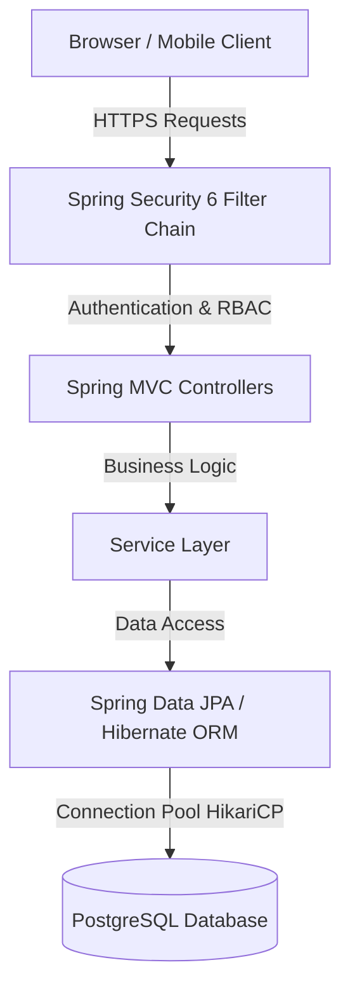

# 📚 LibraryHub — Enterprise Library Management System

[](https://spring.io/projects/spring-boot)
[](https://openjdk.org/)
[](https://spring.io/projects/spring-security)
[](https://www.postgresql.org/)
[](https://www.docker.com/)
[](https://tailwindcss.com/)

**LibraryHub** is a modern, enterprise-grade digital library and asset management platform engineered with **Spring Boot 3**, **Java 21 LTS**, **Spring Security 6**, and **PostgreSQL**. It delivers an automated circulation workflow, real-time catalog search, role-based access control, analytics dashboards, and responsive interfaces powered by Tailwind CSS.

---

## 🏛️ System Architecture



### Architectural Principles
- **Separation of Concerns**: Strict boundary separation across Presentation (Thymeleaf + Tailwind), Controller, Service, and Data Access (Spring Data JPA) layers.
- **Robust Persistence**: Relational data modeling with PostgreSQL, transactional boundaries (`@Transactional`), and optimistic schema synchronization.
- **Zero-Trust Security**: Principle of least privilege enforced through method-level and URL-based authorization filters.

---

## 🛡️ Security Architecture & Authentication

LibraryHub incorporates enterprise security controls powered by **Spring Security 6**:

- **Cryptographic Password Storage**: Utilizes `BCryptPasswordEncoder` with adaptive salting and work factor to protect user credentials against rainbow-table and offline brute-force attacks.
- **Role-Based Access Control (RBAC)**: Distinct authority boundaries separating student privileges (`ROLE_STUDENT`) from administrative controls (`ROLE_ADMIN`).
- **CSRF & Session Fixation Protection**: Cross-Site Request Forgery tokens enforced across all mutating operations (`POST`, `PUT`, `DELETE`).
- **Dynamic Security Redirection**: Authentication success handlers route authenticated principals to their authorized operational dashboard automatically.
- **Configurable Bootstrap Credentials**: Initial administrator provisioning is managed securely via environment parameters rather than committed plain-text credentials.

---

## 👥 Access Matrix & Roles

| Role | Scope | Permitted Capabilities |
| :--- | :--- | :--- |
| **`ROLE_ADMIN`** | Institutional Administration | Catalog CRUD, circulation approvals, student roster auditing, analytics telemetry, stock quota management |
| **`ROLE_STUDENT`** | Student Member | Catalog browsing, self-service book checkout (up to quota limits), loan tracking, 1-click returns, profile management |

> **Note on Initial Provisioning**:
> The system bootstraps an initial administrative user on first boot if no administrator exists. The administrative username and password can be specified via environment variables (`APP_ADMIN_USERNAME` and `APP_ADMIN_PASSWORD`) or configured in deployment secrets. It is strongly recommended to update administrative credentials upon initial sign-in.
>
> New student members can register self-service accounts via the `/register` portal.

---

## ✨ Core Functional Modules

### 📖 Student Circulation Portal
- **Real-Time Catalog Search**: Instant multi-attribute search across book titles, authors, categories, and ISBN identifiers.
- **Self-Service Checkout**: Automated availability verification and immediate loan issuance adhering to institutional lending limits (5 active books maximum).
- **Loan Management**: Visual dashboard monitoring active loans, due date countdowns, and automated overdue flag notifications.
- **Instant Returns**: Self-service book check-in with real-time stock replenishment.

### ⚡ Executive Administration Console
- **Circulation Analytics**: Real-time KPI metric cards (Active Loans, Overdue Items, Inventory Volumes, Member Registrations) paired with **Chart.js** categorical distributions.
- **Catalog Management**: Add, update, and deprecate titles with support for cover imagery, ISBN indexing, and quantity tracking.
- **Student Roster Management**: Comprehensive member directory monitoring borrowing activity, contact details, and account status.
- **Transaction Auditing**: Global transaction log documenting all checkouts, due dates, return timestamps, and system events.

---

## ⚙️ Environment Variables & Configuration

All critical settings and credentials are externalized via standard environment variables:

| Variable | Description | Default (Local Dev) |
| :--- | :--- | :--- |
| `PORT` | Web server listening port | `8085` |
| `SPRING_DATASOURCE_URL` | PostgreSQL JDBC connection URL | `jdbc:postgresql://localhost:5433/LibraryManagementSystem` |
| `SPRING_DATASOURCE_USERNAME` | Database username | `postgres` |
| `SPRING_DATASOURCE_PASSWORD` | Database password | *(managed via secrets)* |
| `SPRING_JPA_HIBERNATE_DDL_AUTO` | Hibernate schema management | `update` |
| `APP_ADMIN_USERNAME` | Bootstrap administrator username | `admin` |
| `APP_ADMIN_PASSWORD` | Bootstrap administrator password | *(configured via environment)* |

---

## ☁️ Cloud Deployment & Containerization

The application is containerized with a production-grade multi-stage Dockerfile and ready for 1-click cloud deployment.

### Deploying via Docker Compose (Any Host / VPS)
Run the entire application stack including PostgreSQL with a single command:
```bash
docker compose up -d
```
The application will be accessible at `http://localhost:8085`.

### Deploying to Render.com (1-Click Free Hosting)
1. Push this repository to your GitHub account.
2. Sign in to [Render.com](https://render.com).
3. Navigate to **New +** ➔ **Blueprint**.
4. Select your repository.
5. Render automatically parses [`render.yaml`](render.yaml), provisions a managed PostgreSQL database, builds the Docker container, and launches the service under HTTPS.

### Deploying to Railway / Fly.io / AWS
This repository includes [`railway.json`](railway.json) and standard Docker packaging compatible with Railway, Fly.io, AWS App Runner, Google Cloud Run, and Kubernetes.

---

## 💻 Local Development Setup

### Prerequisites
- **Java**: OpenJDK 21 LTS or later
- **Build Tool**: Apache Maven 3.9+
- **Database**: PostgreSQL 16+

### Build & Package
```powershell
mvn clean package -DskipTests
```

### Run Executable JAR
```powershell
java -jar LibraryManagementSystem/target/LibraryManagementSystem-1.0.0.jar
```

---

## 📄 License
This project is licensed under the [Apache License 2.0](LICENSE).
